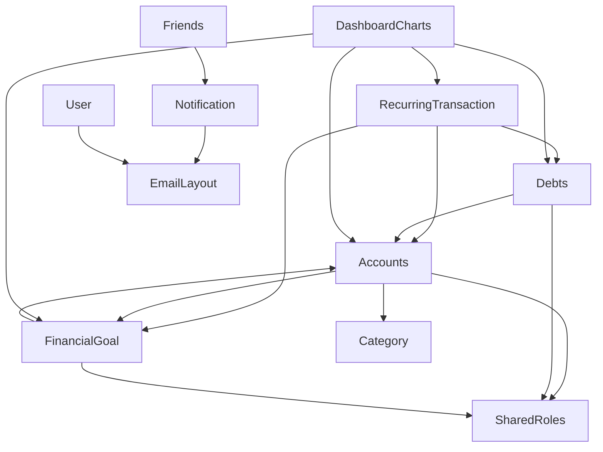

# Mapa de módulos e dependências

Os 18 módulos de `modules_statuses.json` estão ativos na revisão de 20/11/2026. A existência de `Routes/api.php`, de uma policy ou de uma classe de paginação não prova que sejam usadas: o percurso começa sempre na rota e no controller.

| Módulo | Responsabilidade | Dependências principais | Referência |
|---|---|---|---|
| Accounts | Contas, transações, membros, convites e resumos | Currency, Category, SharedRoles, ActivityLog, FinancialGoal (reservas) | [Accounts](modules/accounts.md) |
| Debts | Dívidas, pagamentos e partilha | Accounts/TransactionRepository, SharedRoles, ActivityLog | [Debts](modules/debts.md) |
| FinancialGoal | Metas, ledger de reservas, utilizações e rollout histórico | Accounts, Category, SharedRoles, ActivityLog | [Metas](modules/financial-goal.md) |
| RecurringTransaction | Regras de repetição, geração e resumo | Accounts, Debts, FinancialGoal, Category | [Recorrentes](modules/recurring-transaction.md) |
| Category | Catálogo global, categorias pessoais, arquivo e seleção válida | User, Accounts e RecurringTransaction para referências | [Catálogo](modules/category-currency-dashboard.md) |
| Currency | Moedas, conversão, atualização externa | Language para apresentação, API de câmbios | [Serviços](cross-cutting-services.md) |
| DashboardCharts | Agrega gráficos e widgets | Repositories de Accounts, Debts, FinancialGoal e RecurringTransaction | [Dashboard](modules/category-currency-dashboard.md) |
| User | Perfil, autenticação de suporte e emails transacionais | Permission, UserPreferences, EmailLayout | [Utilizadores](modules/user-friends-notification.md) |
| UserPreferences | Idioma, moeda e middleware `setlocale` | User, Language, Currency | [Autenticação](auth-and-permissions.md) |
| Friends | Amizades, bloqueios e pedidos | User, Notification | [Amigos](modules/user-friends-notification.md) |
| Notification | Feed, preferências, templates e broadcasts | User, EmailLayout, cache e fila | [Serviços](cross-cutting-services.md) |
| EmailLayout | Layouts e tipos dos emails | Configuração de email e dados na BD | [Serviços](cross-cutting-services.md) |
| ActivityLog | Auditoria por conta/dívida/meta | User, traduções e recursos de origem | [Serviços](cross-cutting-services.md) |
| SharedRoles | Papéis e permissões por recurso | Pivots de Accounts, Debts e FinancialGoal | [Permissões](auth-and-permissions.md) |
| Permission | RBAC global do backoffice | User, Gate `authorization` | [Permissões](auth-and-permissions.md) |
| ApiResponder | Envelope de sucesso/erro e paginação | `ApiController`, recursos HTTP | [API](../api/README.md) |
| Language | Catálogo de idiomas | UserPreferences e recursos traduzidos | [Suporte](modules/support.md) |
| Asset | Catálogo financeiro, pesquisa e recolha Python | Currency, processo Python e fontes financeiras | [Suporte](modules/support.md) |

## Dependências a considerar numa alteração

A ligação circular Accounts ↔ FinancialGoal corresponde à consulta de reservas nas contas e à ligação de utilizações a despesas. Alterações no saldo, na visibilidade e no histórico devem ser revistas nos dois lados.

## Superfícies da aplicação

- API de clientes: rotas `api/v1`, Bearer Sanctum na maioria dos domínios; há exceções públicas ou por sessão no catálogo.
- Backoffice: Blade, sessão e permissões globais; verificar middleware real por rota no [inventário](../api/route-inventory.md).
- Console: scheduler, filas, câmbios e rollout das reservas.
- Testes: suites de raiz `tests/Unit` e `tests/Feature`; as pastas `Modules/*/Tests` não estão incluídas automaticamente no `phpunit.xml` atual.
